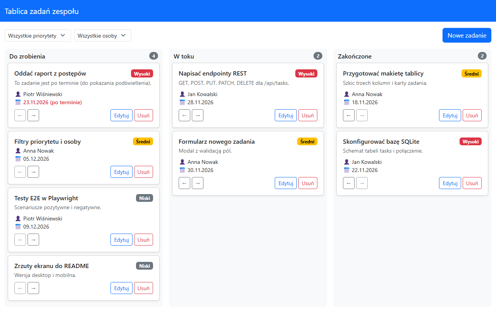
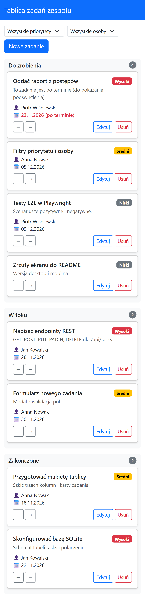
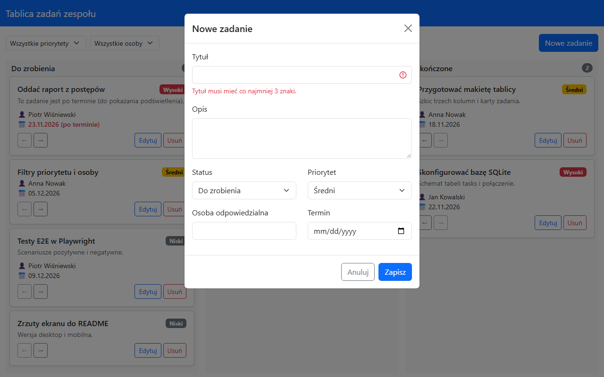

# Tablica Zadań Zespołu (Team Task Board / Kanban)

Projekt zaliczeniowy z przedmiotu: **Frameworki programowania**  
Kierunek: Informatyka, studia I stopnia inżynierskie, semestr VII  



---

## 1. Tytuł i opis projektu
**Tytuł:** Tablica zadań zespołu (Team Kanban Board)  
**Opis:**  
Aplikacja jest przeznaczona dla małych zespołów projektowych i developerskich potrzebujących przejrzystego narzędzia do organizacji codziennej pracy. Rozwiązuje problem chaosu informacyjnego oraz braku transparentności w realizacji zadań wewnątrz zespołu. Umożliwia użytkownikom tworzenie zadań, przypisywanie osób odpowiedzialnych, definiowanie terminów wykonania oraz monitorowanie postępu prac w oparciu o kolumny statusów (np. *Do zrobienia*, *W toku*, *Zakończone*). Dzięki intuicyjnemu interfejsowi członkowie zespołu mogą łatwo edytować parametry zgłoszeń, aktualizować ich stan oraz filtrować zadania według priorytetów i wykonawców.

## 2. Rodzaj aplikacji
* **Aplikacja webowa** (responsywna, dostosowana do urządzeń desktopowych oraz mobilnych).

## 3. Główny zasób (operacje CRUD)
Głównym zasobem aplikacji jest **Zadanie** (`Task`), reprezentowane przez następujące pola:
* `id` – unikalny identyfikator zadania,
* `title` – tytuł / krótka nazwa zadania (od 3 do 120 znaków),
* `description` – szczegółowy opis zadania (do 2000 znaków),
* `status` – status zadania (`TODO` / `IN_PROGRESS` / `DONE`),
* `priority` – priorytet (`LOW` / `MEDIUM` / `HIGH`),
* `assignee` – osoba przypisana (imię/nazwisko lub email wykonawcy),
* `dueDate` – planowany termin realizacji (`RRRR-MM-DD`),
* `createdAt` – data utworzenia zadania (ISO 8601, UTC).

## 4. Wybrane frameworki i uzasadnienie wyboru

| Kategoria | Wybrany framework | Uzasadnienie wyboru |
| :--- | :--- | :--- |
| **A – Framework aplikacji** | **Next.js** (App Router) | Umożliwia budowę pełnej aplikacji webowej w jednym spójnym projekcie (Fullstack), łącząc renderowanie interfejsu (React) z dedykowanymi handlerami API REST (`Route Handlers`) i obsługą bazy SQLite. |
| **B – Framework UI** | **Bootstrap 5** | Zapewnia gotowy, sprawdzony system siatki (Grid) oraz bogaty zestaw responsywnych komponentów (karty Kanban, modale, formularze, badge'e statusów), co pozwala na szybką budowę spójnego i czytelnego UI. |
| **C – Framework testowy** | **Playwright** | Pozwala na nowoczesne, niezawodne testowanie scenariuszy End-to-End (E2E) w rzeczywistych przeglądarkach, idealnie sprawdzając się przy testach formularzy, przepływu zmiany statusów zadań i scenariuszy negatywnych. |

## 5. Link do repozytorium
* **URL:** [https://github.com/Paziowsky/tablica-kanban](https://github.com/Paziowsky/tablica-kanban)

---

## 6. Architektura i środowisko

* **Runtime:** Node.js `>= 22` (wymaga tego `better-sqlite3`; rozwijane na Node 22–26)
* **Warstwa danych:** baza SQLite (biblioteka `better-sqlite3`), plik `data/kanban.db` (ścieżkę można zmienić zmienną `DB_PATH`)
* **Architektura API:** RESTful API obsługujące metody `GET`, `POST`, `PUT`, `PATCH`, `DELETE` wraz z kodami `200`, `201`, `204`, `400`, `404`

```
app/
  page.js, layout.js          # strona z tablicą (nawigacja + komponent Board)
  api/tasks/route.js          # GET (lista), POST (tworzenie)
  api/tasks/[id]/route.js     # GET, PUT, PATCH, DELETE
components/                   # Board, TaskCard, TaskFormModal, Filters, ConfirmDelete, Modal
lib/
  db.js                       # połączenie z SQLite i schemat tabeli
  tasks.js                    # operacje na zadaniach (prepared statements)
  validation.js               # reguły walidacji wspólne dla API
  http.js                     # format błędów, odczyt JSON
scripts/seed.js               # przykładowe dane
tests/                        # testy Playwright: API, walidacja, interfejs
```

## 7. Uruchomienie

### Wymagania
* Node.js 22 lub nowszy oraz npm
* Git

### Instalacja

```bash
git clone https://github.com/Paziowsky/tablica-kanban.git
cd tablica-kanban
npm ci
npx playwright install chromium   # przeglądarka potrzebna tylko do testów
```

> **Windows:** jeśli `npm ci` kończy się błędem `node-gyp` przy `better-sqlite3` („Could not find any Visual Studio
> installation”), użyj `npm ci --ignore-scripts`. Paczka zawiera gotową bibliotekę dla Windows, więc kompilacja
> nie jest potrzebna.

### Przykładowe dane

```bash
npm run db:seed      # tworzy data/kanban.db z 8 przykładowymi zadaniami (w tym jednym po terminie)
```

Ponowne uruchomienie czyści tabelę i wstawia dane od nowa.

### Tryb deweloperski

```bash
npm run dev          # http://localhost:3000
```

### Wersja produkcyjna

```bash
npm run build
npm start            # http://localhost:3000
```

### Lint

```bash
npm run lint
```

## 8. Testy (Playwright)

```bash
npm run test:e2e             # wszystkie testy
npx playwright show-report   # raport HTML z ostatniego uruchomienia
npx playwright test --project=chromium          # tylko testy interfejsu na komputerze
npx playwright test tests/api.spec.js           # jeden plik
```

Przed testami Playwright sam buduje aplikację i uruchamia ją na porcie `3100` z osobną bazą `data/test.db`,
więc testy nie zmieniają danych z `data/kanban.db`. Przed każdym testem tablica jest czyszczona.

| Projekt | Pliki | Co sprawdza |
| :-- | :-- | :-- |
| `api` | `tests/api.spec.js`, `tests/validation.spec.js` | endpointy REST (kody 200/201/204/400/404, format błędów) i reguły walidacji |
| `chromium` | `tests/ui.spec.js` | interfejs na komputerze (Desktop Chrome) |
| `mobile` | `tests/ui.spec.js` | ten sam interfejs na telefonie (Pixel 7) |

Scenariusze interfejsu:
* **pozytywne:** trzy kolumny, tworzenie zadania, edycja tytułu i priorytetu, przenoszenie między kolumnami,
  usuwanie z potwierdzeniem, filtry priorytetu i osoby, zachowanie danych po odświeżeniu, wyróżnienie zadań po terminie;
* **negatywne:** pusty lub za krótki tytuł, niepoprawna data, anulowanie usuwania, zamknięcie formularza klawiszem Escape.

Testy uruchamiają się też automatycznie w GitHub Actions przy każdym pushu i pull requeście
(`.github/workflows/tests.yml`).

## 9. REST API

| Metoda | Adres | Sukces | Błędy |
| :-- | :-- | :-- | :-- |
| `GET` | `/api/tasks?status=&priority=&assignee=` | `200` + lista zadań | `400` nieznana wartość filtra |
| `POST` | `/api/tasks` | `201` + utworzone zadanie, nagłówek `Location` | `400` błąd walidacji lub niepoprawny JSON |
| `GET` | `/api/tasks/:id` | `200` + zadanie | `400` niepoprawne id, `404` |
| `PUT` | `/api/tasks/:id` | `200` + zadanie (pola pominięte wracają do wartości domyślnych) | `400`, `404` |
| `PATCH` | `/api/tasks/:id` (np. `{ "status": "DONE" }`) | `200` + zadanie (zmienia tylko wysłane pola) | `400`, `404` |
| `DELETE` | `/api/tasks/:id` | `204` (bez treści) | `400`, `404` |

Format błędu:

```json
{ "error": "Validation failed", "details": { "title": "Tytuł musi mieć co najmniej 3 znaki." } }
```

Przykład:

```bash
curl -X POST http://localhost:3000/api/tasks \
  -H "Content-Type: application/json" \
  -d '{"title": "Nowe zadanie", "priority": "HIGH", "assignee": "Anna Nowak", "dueDate": "2026-12-31"}'
```

## 10. Zrzuty ekranu

| Telefon | Formularz z błędem walidacji |
| :-: | :-: |
|  |  |
